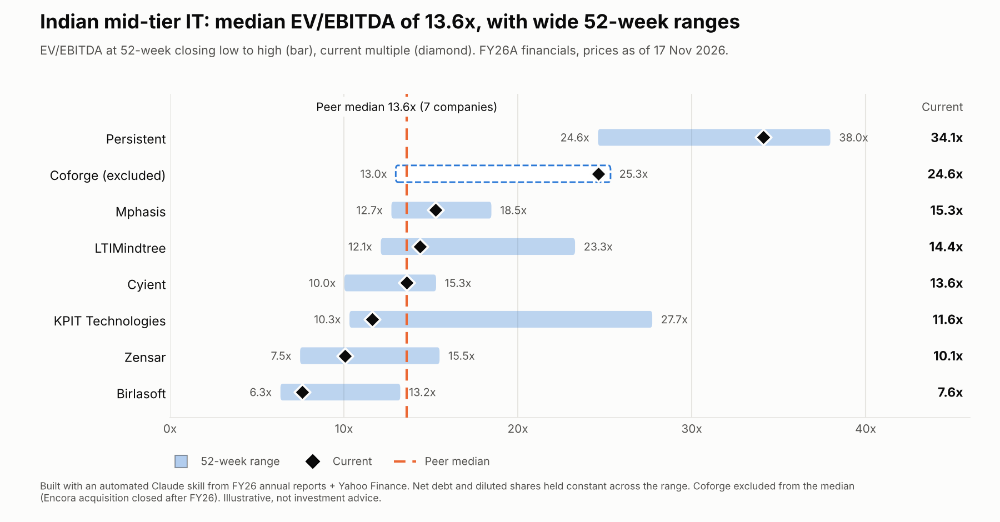

# Indian IT Trading Comps: a Claude Code Skill

A Claude Code skill that builds a trading-comparables workbook for Indian listed IT services companies. Drop in each company's consolidated annual report PDF, run one command, and get an Excel file with EV/Revenue, EV/EBITDA and P/E for every peer, peer statistics, and a page-cited audit log.



See also: [one-page summary](examples/Comps_Engine_One_Pager.pdf) and an [example workbook](examples/trading_comps_example.xlsx).

## What it does

- Reads the consolidated financial statements from each annual report PDF
- Pulls current prices and share data from Yahoo Finance (`yfinance`)
- Builds the enterprise value bridge on diluted shares (treasury stock method)
- Computes EV/Revenue, EV/EBITDA and adjusted P/E
- Writes `output/trading_comps_<timestamp>.xlsx` with **live Excel formulas**, peer median and quartiles, and a log that cites the source page for every extracted figure

Default peer set: Cyient, Zensar, LTIMindtree, KPIT Technologies, Birlasoft, Coforge, Persistent Systems and Mphasis.

## How it works

The design rule is that **the language model never does arithmetic**. It only reads pages and extracts numbers. All calculations happen in Python or in Excel formulas.

1. **Prep (deterministic).** A script indexes each PDF and slices out only the pages that matter (balance sheet, P&L, cash flow, share capital, notes).
2. **Extract (parallel).** One Claude subagent per company reads its pages and writes structured JSON against a fixed schema, following a written accounting brief.
3. **Finish (deterministic).** Scripts validate every extraction against the schema, fetch market data, check share counts against the annual report, build the workbook, and re-verify it.

An independent Python recalculation re-checks every formula cell. On the included example, all 168 of 168 formula checks matched, with no Excel errors.

## Indian-market handling

- Consolidated figures, with Ind AS 116 lease treatment
- Cash includes mutual funds, InvITs and bonds, not only bank balances
- Non-controlling interest in a listed subsidiary is valued at market (for example Cyient's stake in Cyient DLM), not book value
- ESOP trust shares and employee options flow into diluted shares
- Bonus issues, splits and approved vs executed buybacks are checked against the annual report share bridge
- Peers are excluded from statistics with a stated reason when a recent acquisition distorts the multiple

## Quick start

Requirements: [Claude Code](https://claude.com/claude-code), Python 3, and the eight annual report PDFs.

```bash
git clone https://github.com/abhinavkurra/Indian-IT-trading-comps-claude-skill.git
cd Indian-IT-trading-comps-claude-skill
pip install -r .claude/skills/indian-it-comps/requirements.txt
```

1. Download each company's consolidated annual report from its investor relations page or from the NSE/BSE filings site.
2. Put the PDFs in `input_pdfs/`, named to match `.claude/skills/indian-it-comps/config/peers.yaml`.
3. Open Claude Code in the project folder and run `/indian-it-comps`.
4. Read the result in `output/`.

The annual report PDFs are not included in this repository.

## Project layout

```
.claude/skills/indian-it-comps/
  SKILL.md        # instructions Claude follows
  scripts/        # prep, extraction checks, market data, workbook build, verification
  reference/      # accounting rules, extractor brief, JSON schema
  config/         # peers, accounting policy, documented share changes
  tests/golden/   # expected figures for regression checks (Birlasoft, Coforge)
examples/         # sample workbook, football field chart, one-pager
```

## Adding a peer

Add an entry to `config/peers.yaml` (company id, name, NSE ticker, PDF filename and any listed subsidiaries), then drop the PDF into `input_pdfs/`.

## Current limitations

- **Annual figures only.** It uses full-year reports and does not yet build last-twelve-months (LTM) numbers from half-year results, so figures can lag recent quarters.
- **Post-year-end events.** Acquisitions and buybacks after the report date are not captured automatically. They must be added by hand to the config files.
- **ESOP dilution is partial** for some companies.
- **Share counts for Persistent and Cyient** come from Yahoo Finance and are not fully reconciled to the annual report.
- **Market data quality** depends on Yahoo Finance, which can be inconsistent.
- **Windows-tested.** The skill has been run on Windows with Git Bash.

## Roadmap

- LTM builds from half-yearly results
- An event scanner for acquisitions and buybacks announced after the report date
- Fuller ESOP dilution for all peers
- Reconciliation of all share counts to filings

## Disclaimer

For education and demonstration only. Not investment advice. Verify all figures against company filings before relying on them.
